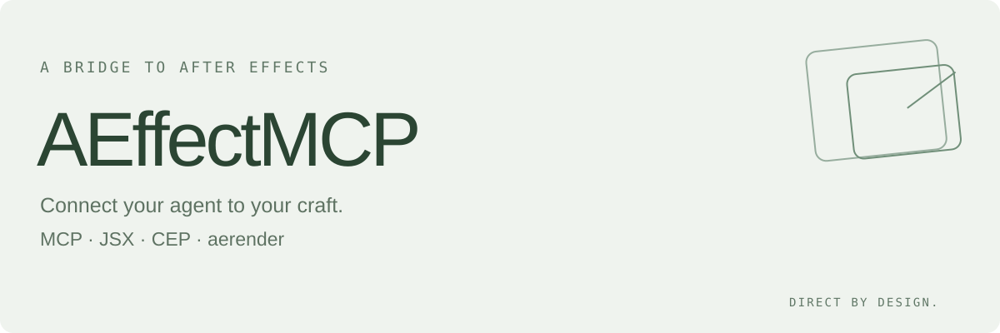
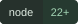
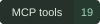
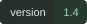

<picture>
  <source media="(prefers-color-scheme: dark)" srcset="assets/banner-dark.svg">
  <source media="(prefers-color-scheme: light)" srcset="assets/banner-light.svg">
  
</picture>

<p>
  <a href="LICENSE"></a>
  
  
  
</p>

[English](README.md) · [中文说明](README.zh-CN.md)

**AEffectMCP** connects programmatic tools to the real After Effects host, with structured results and render evidence.

Control, debug and test Adobe After Effects through MCP, JSX, CEP bridges and aerender, without computer use. Includes a local stdio MCP server and an optional Codex skill.

The server has **zero npm dependencies**. Node.js 22 or newer is required. After Effects must already be installed.

**Real host access** — JSX execution and CEP scripting bridges.<br>
**Clear evidence** — Diagnostics, assertions and independent render jobs.

## Tools

| Tool | Purpose |
| --- | --- |
| `ae_discover` | Find AE executables, running Windows hosts and installed CEP roots |
| `ae_cep_targets` | List targets on an explicit local CEP debug port |
| `ae_inspect_host` | Read AE version, project, comp/layers, render queue and optional effect registry |
| `ae_execute_jsx` | Run a JSX function body or script file through AfterFX or a real CEP bridge |
| `ae_evaluate_panel` | Inspect or operate a CEP panel's DOM/runtime through CDP |
| `ae_collect_diagnostics` | Collect Windows manifest, installation and log evidence |
| `ae_render_start` | Start a separate aerender job with a unique output directory |
| `ae_render_status` | Read job status, exit code, logs and output inventory |
| `ae_test_session_create` | Create a managed temporary session for disposable test projects |
| `ae_test_cleanup` | Preview or delete eligible managed test sessions on Windows |
| `ae_jsx_status` | Inspect a previous CLI JSX result after a timeout |
| `ae_collab_*` | Share a disposable AEP across agents with comp claims, notes, serialized writes, and manual recovery |

## Quick start

```sh
git clone https://github.com/Misaoys/AEffectMCP.git
cd AEffectMCP
node scripts/ae-mcp.mjs --call ae_discover
```

To run the MCP server:

```sh
node scripts/ae-mcp.mjs --stdio
```

Stdout is reserved for MCP JSON-RPC. Do not paste interactive commands into the server's stdin.

### Connect to Codex

Add the following to your MCP configuration. Replace the repository and executable paths with paths verified on your machine. Windows paths can use forward slashes in TOML.

```toml
[mcp_servers.ae-mcp]
command = 'node'
args = ['C:/tools/AEffectMCP/scripts/ae-mcp.mjs', '--stdio']
startup_timeout_sec = 10
tool_timeout_sec = 60
enabled = true
env_vars = ['ALLUSERSPROFILE', 'CommonProgramFiles', 'CommonProgramFiles(x86)', 'CommonProgramW6432', 'COMPUTERNAME', 'OS', 'ProgramData', 'ProgramFiles(x86)', 'ProgramW6432', 'PUBLIC', 'TMP', 'USERDOMAIN', 'USERDOMAIN_ROAMINGPROFILE', 'windir']

[mcp_servers.ae-mcp.env]
AE_MCP_AFTERFX = 'C:/Program Files/Adobe/Adobe After Effects 2025/Support Files/AfterFX.com'
AE_MCP_AERENDER = 'C:/Program Files/Adobe/Adobe After Effects 2025/Support Files/aerender.exe'
```

Reconnect your MCP client and confirm that it lists the 19 tools. Installing the skill alone does not register the server.

The Windows environment forwarding above was verified with the official MCP SDK. Its default reduced environment did not deliver an AE result on the tested machine; the supplied system-only set restored the full host/render flow. Other clients should preserve the corresponding system variables without forwarding unrelated credentials.

### Optional Codex skill

Clone this repository into your Codex skills directory under the name `ae-mcp`, or copy the repository's `SKILL.md`, `agents/`, `assets/`, `references/` and `scripts/` into that directory. Then use `$ae-mcp`. Keep the MCP command pointed at the actual installed script location.

The project is named AEffectMCP. The `ae-mcp` skill/config key, script filename and existing `ae_*` tools remain compatible with previous installations.

### Connect to Trae on Windows

Open Settings → MCP → Add → manual configuration and merge the following entry into your existing configuration. Replace all paths with the actual Node, repository and AE paths on your machine:

```json
{
  "mcpServers": {
    "ae-mcp": {
      "command": "C:/Program Files/nodejs/node.exe",
      "args": ["C:/tools/AEffectMCP/scripts/ae-mcp.mjs", "--stdio"],
      "env": {
        "AE_MCP_AFTERFX": "C:/Program Files/Adobe/Adobe After Effects 2025/Support Files/AfterFX.com",
        "AE_MCP_AERENDER": "C:/Program Files/Adobe/Adobe After Effects 2025/Support Files/aerender.exe"
      }
    }
  }
}
```

Reload the server or restart Trae and check for 19 tools. The client must inherit the necessary Windows system environment; see the [transport reference](references/mcp-control.md#installation-and-connection) if AE delivery fails.

### Updating

Check `git status` in the clone and preserve any local changes, then run `git pull --ff-only`. If the MCP configuration points at a separately copied installation, update that copy including `assets/` and `scripts/`, or point the client to the clone. Reload the MCP client.

## Multi-agent testing

Create a disposable shared AEP with `ae_collab_create`. To test an existing saved AEP/AEPX, provide its absolute `sourceProjectPath`; the server verifies and opens a temporary copy, then returns composition IDs and missing-footage information. Share its `sessionId`, have each agent claim a distinct comp with `ae_collab_claim`, and perform verified writes via `ae_collab_run`. Agents can exchange notes through `ae_collab_note` and inspect claims and lock status with `ae_collab_status`. Release claims and close the session before managed cleanup.

Writes are serialized across MCP processes, not simultaneous editing. Claims are cooperative: arbitrary JSX, other AE processes and older MCP servers can bypass them. All writers must use the collaboration API. Failure or timeout leaves the lock in place; `ae_collab_resolve` requires manual confirmation that every helper has stopped and the saved project has been inspected. Never retry an unknown mutation automatically. Only the saved on-disk project is copied; unsaved changes are excluded. Duplicate composition names can be selected by `compId`. Linked media, fonts and plugins are not copied or sandboxed, and arbitrary JSX can still write outside the copy. Review missing footage and preserve desired results explicitly; no automatic write-back is performed. [Full workflow and limitations](references/mcp-control.md#multiple-agents-sharing-a-test-aep).

## Run an isolated AE probe

Create an arguments file outside the source tree's tracked files:

```json
{
  "launchMode": "isolated",
  "afterfxPath": "C:/Program Files/Adobe/Adobe After Effects 2025/Support Files/AfterFX.com",
  "workDir": "C:/projects/my-project/work/ae-mcp",
  "timeoutMs": 55000
}
```

```sh
node scripts/ae-mcp.mjs --call ae_inspect_host --args-file C:/projects/my-project/work/inspect-args.json
```

`isolated` uses `-m -noui -r`, checks for an empty initial project and asks the owned helper to exit after evaluation. It does not read the user's current project or prove visible panel behavior. The default `existing` mode uses the regular host. CDP attaches to a selected real CEP target and calls the Adobe `evalScript` bridge.

For an edit, use `ae_execute_jsx` with exactly one of `code` or an absolute `scriptPath`. `code` is a function body returning JSON-compatible data; `undoGroup` optionally groups reversible edits. Always assert the actual postconditions. Arbitrary JSX and panel expressions can modify projects/files: they are not sandboxed.

For disposable JSX/AEX tests, call `ae_test_session_create`, save the new test project at its returned `projectPath`, and use `sessionDir` as `workDir`. `ae_test_cleanup` previews by default; `{ "delete": true }` deletes eligible managed sessions, optionally scoped with `sessionId`. Windows cleanup skips incomplete/unknown runs and reparse points; it does not close projects or clean older unmanaged paths. Stop using the session and preserve wanted files elsewhere first. Paths are a convention, not a sandbox.

For scripts that change state, supply `verifyCode`, an independent ES3 function body that checks the actual postcondition and returns exactly `true`. Without it, `verificationStatus` is `not_requested`; script delivery alone does not establish feature behavior. Effects require their own render/pixel checks. For a CLI timeout, `ae_jsx_status` can inspect the reported `resultPath`; CDP timeouts do not have a late result file.

Supply an absolute task-owned `workDir` for file-producing calls. An execution timeout stops waiting; it does **not** cancel an AE operation. Inspect the result and project state before retrying a mutation.

Read [the transport and tool reference](references/mcp-control.md) for schemas, render jobs, diagnostics and more examples.

## Verification and limits

- Windows AE 25.6.4 also passed a managed temporary-project save and host postcondition check; the test session was deleted.
- 22 Node regression tests cover JSON serialization, host checks, isolated helper ownership, MCP protocol, CDP callbacks/errors/timeouts and asynchronous render failure reporting.
- The PowerShell collector has 10 regression scenarios for manifest/resources, path containment, debug ports and installed-file parity.
- A Windows AE 25.5x4 test through the official MCP SDK verified compositions, layers, keyframes, expressions, markers, reopening a saved test project and the native `ADBE Fill` effect.
- An actual aerender job produced 25 frames of 64×64 RGBA TIFF. All 409,600 decoded samples matched the analytical premultiplied color/opacity expectation at the adjacent 8-bit quantization levels.

CI tests use fixtures and do not install or run Adobe software. Real CEP panel/CDP behavior, visible ScriptUI, third-party AEX effects, MFR, GPU backends and other host/version combinations require their own live tests. The bundled AfterFX CLI and PowerShell diagnostics support Windows; other platforms may use a compatible exposed CEP endpoint. macOS has not been validated.

Source, build, package, installed-file parity, loader recognition and actual host/render evidence are distinct. See [the evidence ladder](references/evidence-ladder.md).

## Development

```sh
npm test
```

On Windows:

```powershell
npm run test:collector
```

No `npm install` is required. Test artifacts belong under `work/` and are ignored by Git. Never submit host logs, saved projects, rendered frames or credentials with an issue; provide a redacted scenario and relevant error details.

## License

[MIT](LICENSE). Adobe After Effects and Adobe SDK/runtime components are not included. This project is not affiliated with Adobe.
