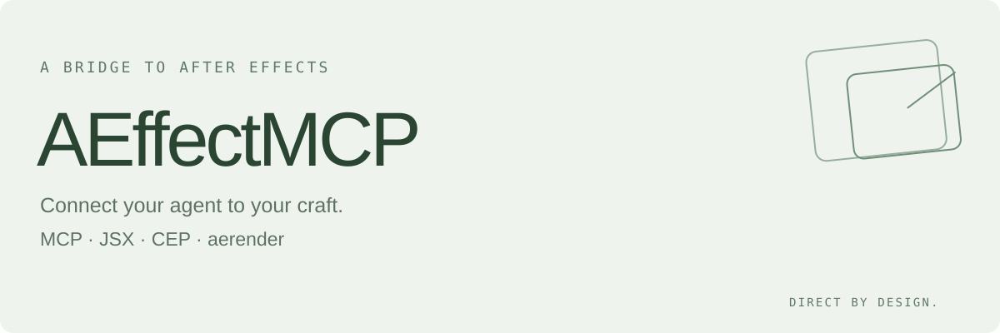
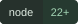
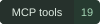
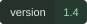

<picture>
  <source media="(prefers-color-scheme: dark)" srcset="assets/banner-dark.svg">
  <source media="(prefers-color-scheme: light)" srcset="assets/banner-light.svg">
  
</picture>

<p>
  <a href="LICENSE"></a>
  
  
  
</p>

[English](README.md) · [中文说明](README.zh-CN.md)

**AEffectMCP** 通过程序化接口连接真实 After Effects 宿主，返回结构化结果与渲染证据。

通过 MCP、JSX、CEP 桥接和 aerender 调试、测试与控制 Adobe After Effects，无需 computer use。仓库包含本地 stdio MCP 服务，也可作为 Codex 技能使用。

## 能做什么

- 读取 AE 版本、工程、合成、图层、渲染队列和效果注册信息。
- 执行 JSX，操作合成、关键帧、表达式、标记和原生效果。
- 通过 CEP 调试端口访问真实面板的 DOM、运行时与脚本桥接。
- 采集 Windows CEP 安装、清单和日志信息。
- 启动独立 aerender 任务，读取状态、退出码及输出文件。
- 为 JSX/AEX 测试创建临时会话，执行后检查宿主状态，并通过 PowerShell 清理托管测试文件。

## 安装

需要 Node.js 22+ 和已安装的 After Effects。MCP 服务没有 npm 运行依赖。

```sh
git clone https://github.com/Misaoys/AEffectMCP.git
cd AEffectMCP
node scripts/ae-mcp.mjs --call ae_discover
```

### 接入 Trae（Windows）

在 Trae 的「设置 → MCP → 添加 → 手动配置」中添加以下 JSON，或将 `mcpServers` 下的条目合并到 Trae 的全局 `mcp.json`。不要覆盖现有服务器。把路径改成自己的 Node、仓库和 AE 实际路径：

```json
{
  "mcpServers": {
    "ae-mcp": {
      "command": "C:/Program Files/nodejs/node.exe",
      "args": ["C:/tools/AEffectMCP/scripts/ae-mcp.mjs", "--stdio"],
      "env": {
        "AE_MCP_AFTERFX": "C:/Program Files/Adobe/Adobe After Effects 2025/Support Files/AfterFX.com",
        "AE_MCP_AERENDER": "C:/Program Files/Adobe/Adobe After Effects 2025/Support Files/aerender.exe"
      }
    }
  }
}
```

重新加载 MCP 或重启 Trae，检查 `ae-mcp` 是否显示 19 个工具。以上配置依赖客户端继承 Windows 系统环境变量；如果出现 AE 无结果而直接命令可用，参见 [Windows 环境变量说明](references/mcp-control.md#installation-and-connection)。

### 接入 Codex

参照 [Codex 配置示例](README.md#connect-to-codex)，将路径替换为实际值并重启或重新加载 MCP。Windows 配置中请保留示例的系统环境变量转发。

### 更新已有安装

在你克隆的仓库目录执行 `git status`，确认没有需要保留的本地改动后运行 `git pull --ff-only`。如果 MCP 配置指向单独复制的技能目录，更新仓库不会自动更新该副本；应同步 `SKILL.md`、`agents/`、`assets/`、`references/` 和 `scripts/`，或将配置指向克隆仓库，再重启 MCP。安装前后可运行 `node scripts/ae-mcp.mjs --call ae_discover` 检查启动。

如需 Codex 技能，将仓库克隆到 skills 目录，文件夹命名为 `ae-mcp`，再使用 `$ae-mcp`。技能安装与 MCP 服务注册是两件事。

项目名称为 AEffectMCP；保留 `ae-mcp` 技能/配置键、脚本文件名和原有 `ae_*` 工具，兼容已经安装的调用方式。

## 多个 Agent 协作测试

调用 `ae_collab_create` 创建共享临时 AEP；要测试已有工程时，在 `sourceProjectPath` 填入已保存的 AEP/AEPX 绝对路径，MCP 会校验并打开临时副本，返回合成 ID 与缺失素材信息。把返回的 `sessionId` 分配给各 agent。每个 agent 通过 `ae_collab_claim` 认领不同合成，使用 `ae_collab_run` 执行 JSX 和结果断言；通过 `ae_collab_note` / `ae_collab_status` 共享进度。需要移交时先释放认领，全部结束后释放所有认领并关闭会话，再清理临时目录。

写入在不同 MCP 进程之间串行执行，不是多个 AE 进程同时编辑。认领是协作约定：直接运行 JSX、其他 AE 进程或旧版 MCP 都能绕过它，因此所有写入方必须使用协作接口。执行失败或超时后锁会保留；只有人工确认所有辅助进程已退出并检查已保存工程后，才能使用 `ae_collab_resolve`。不要自动重试状态不明的操作。副本只包含磁盘上已保存的工程，不包含 AE 中未保存的修改。同名合成需用 `compId` 区分。素材、字体和插件不会随工程复制，任意 JSX 也不受沙箱限制，仍可能写入原工程或外部文件。请检查缺失素材并自行保留需要的测试结果；不会自动写回原工程。[完整流程与限制](references/mcp-control.md#multiple-agents-sharing-a-test-aep)。

## 真实宿主与隔离测试

默认 `launchMode="existing"` 用于常规宿主。自动测试可选择 `launchMode="isolated"`，通过 `-m -noui -r` 启动独立空工程，执行后自行退出。隔离模式不读取用户当前工程，也不能验证可见面板表现。

JSX 与面板表达式可以修改工程和文件。执行 JSX 时可提供 `verifyCode`，用独立的 ES3 函数体检查 AE 状态，并返回严格的 `true`；未提供时 `verificationStatus` 为 `not_requested`，不能仅凭执行成功宣称效果正确。效果渲染正确性仍需独立检查像素或画面。

测试流程：先调用 `ae_test_session_create`，将新建测试工程保存在返回的 `projectPath`，并将 `sessionDir` 作为测试调用的 `workDir`。测试结束后调用 `ae_test_cleanup`：默认预览，传入 `{"delete": true}` 一键删除符合条件的托管会话，可增加 `sessionId` 限定单个会话。清理会跳过状态未知或未完成的任务以及含链接的目录；不会关闭工程，也不会清理旧的非托管目录。确认会话已停止使用，并先移出需要保留的文件。

超时不会取消 AE 操作。CLI 超时返回的 `resultPath` 可交给 `ae_jsx_status` 查询；CDP 超时没有可供事后查询的结果文件。状态未知时不要自动重试修改。临时路径和断言由调用方选择，任意 JSX 仍可在其他位置创建文件。

详细工具和传输说明见 [mcp-control.md](references/mcp-control.md)。

## 验证

- 22 项 Node 回归测试和 10 个 PowerShell 采集器场景。
- AE 25.6.4 Windows 隔离实例通过临时工程保存和执行后断言；清理验证删除了该测试会话。
- 官方 MCP SDK 在真实 AE 25.5x4 中完成合成、图层、关键帧、表达式、标记、工程重开及原生 Fill 效果测试。
- aerender 输出 25 帧 64×64 TIFF，409,600 个 RGBA 样本全部符合预乘颜色、透明度变化和 8 位导出量化预期。

CI 使用模拟宿主，不运行 Adobe。真实 CEP 面板、可见 ScriptUI、其他第三方 AEX、MFR、GPU 后端和其他版本/平台尚需独立实测。源码、安装、加载及渲染证据分层记录。

```sh
npm test
```

Windows 采集器测试：

```powershell
npm run test:collector
```

不要提交本机日志、测试工程、渲染文件或凭据。

## 许可证

[MIT](LICENSE)。不包含 Adobe 软件、SDK 或运行时，不属于 Adobe 官方项目。
