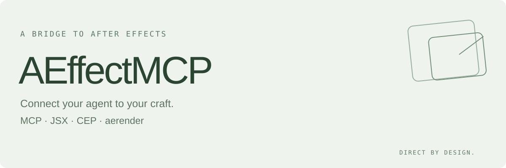
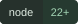
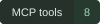
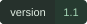

<picture>
  <source media="(prefers-color-scheme: dark)" srcset="assets/banner-dark.svg">
  <source media="(prefers-color-scheme: light)" srcset="assets/banner-light.svg">
  
</picture>

<p>
  <a href="LICENSE"></a>
  
  
  
</p>

[English](README.md) · [中文说明](README.zh-CN.md)

**AEffectMCP** 通过程序化接口连接真实 After Effects 宿主，返回结构化结果与渲染证据。

通过 MCP、JSX、CEP 桥接和 aerender 调试、测试与控制 Adobe After Effects，无需 computer use。仓库包含本地 stdio MCP 服务，也可作为 Codex 技能使用。

## 能做什么

- 读取 AE 版本、工程、合成、图层、渲染队列和效果注册信息。
- 执行 JSX，操作合成、关键帧、表达式、标记和原生效果。
- 通过 CEP 调试端口访问真实面板的 DOM、运行时与脚本桥接。
- 采集 Windows CEP 安装、清单和日志信息。
- 启动独立 aerender 任务，读取状态、退出码及输出文件。

## 安装

需要 Node.js 22+ 和已安装的 After Effects。MCP 服务没有 npm 运行依赖。

```sh
git clone https://github.com/Misaoys/AEffectMCP.git
cd AEffectMCP
node scripts/ae-mcp.mjs --call ae_discover
```

完整 MCP 配置见 [英文说明中的 Codex 配置](README.md#connect-to-codex)。替换仓库和 AE 的示例路径，保留 Windows 系统变量转发，然后重新连接 MCP 客户端。

如需 Codex 技能，将仓库克隆到 skills 目录，文件夹命名为 `ae-mcp`，再使用 `$ae-mcp`。技能安装与 MCP 服务注册是两件事。

项目名称为 AEffectMCP；保留 `ae-mcp` 技能/配置键、脚本文件名和原有 `ae_*` 工具，兼容已经安装的调用方式。

## 真实宿主与隔离测试

默认 `launchMode="existing"` 用于常规宿主。自动测试可选择 `launchMode="isolated"`，通过 `-m -noui -r` 启动独立空工程，执行后自行退出。隔离模式不读取用户当前工程，也不能验证可见面板表现。

JSX 与面板表达式可以修改工程和文件。调用时给出当前任务的绝对 `workDir`，返回明确的状态断言。超时不会取消 AE 操作；先核对结果和工程状态，再决定是否重试。

详细工具和传输说明见 [mcp-control.md](references/mcp-control.md)。

## 验证

- 13 项 Node 回归测试和 10 个 PowerShell 采集器场景。
- 官方 MCP SDK 在真实 AE 25.5x4 中完成合成、图层、关键帧、表达式、标记、工程重开及原生 Fill 效果测试。
- aerender 输出 25 帧 64×64 TIFF，409,600 个 RGBA 样本全部符合预乘颜色、透明度变化和 8 位导出量化预期。

CI 使用模拟宿主，不运行 Adobe。真实 CEP 面板、可见 ScriptUI、其他第三方 AEX、MFR、GPU 后端和其他版本/平台尚需独立实测。源码、安装、加载及渲染证据分层记录。

```sh
npm test
```

Windows 采集器测试：

```powershell
npm run test:collector
```

不要提交本机日志、测试工程、渲染文件或凭据。

## 许可证

[MIT](LICENSE)。不包含 Adobe 软件、SDK 或运行时，不属于 Adobe 官方项目。
